# Awesome Attack Surface Management (ASM) 🛡️

  

  
  
  
  
  

---

> ⚡ **A curated directory of premier SaaS platforms and battle-tested open-source repositories for External Attack Surface Management (EASM), Cyber Asset Attack Surface Management (CAASM), and Continuous Threat Exposure Management (CTEM).**

---

## 📑 Table of Contents

- [🌐 Sector Overview & Market Dynamics](#-sector-overview--market-dynamics)
- [🏢 SaaS / Hosted Platforms](#-saas--hosted-platforms)
- [💻 Open-Source GitHub Projects](#-open-source-github-projects)
  - [Top Open-Source ASM & Recon Tools (Ranked by Stars)](#top-open-source-asm--recon-tools-ranked-by-stars)
  - [Architectural Blueprint for Custom ASM Pipelines](#architectural-blueprint-for-custom-asm-pipelines)
- [🤝 How to Contribute](#-how-to-contribute)
- [💖 Support](#-support)
- [📈 Star History](#-star-history)
- [⚠️ Disclaimer](#️-disclaimer)

---

## 🌐 Sector Overview & Market Dynamics

The global **Attack Surface Management (ASM)** market is estimated between **$1.25 billion and $1.86 billion** in 2025–2026, projected to surpass **$5.74 billion by 2030** with an exceptional Compound Annual Growth Rate (CAGR) of roughly **24% to 31%**.

The sector is **moderately to highly fragmented and intensely competitive** rather than a winner-take-all monopoly:
- **Enterprise Consolidation**: Major cybersecurity titans (such as Palo Alto Networks and CrowdStrike) continuously acquire agile EASM pioneers to bundle attack-surface mapping into broader XDR, SIEM, and Continuous Threat Exposure Management (CTEM) ecosystems.
- **Specialized Innovators**: Pure-play mapping engines (Censys, ProjectDiscovery, Hadrian) maintain technological moats through proprietary global cartography, high-frequency full-port indexing, or agentic autonomous penetration testing.
- **Open-Source Foundations**: Modern security engineering teams increasingly pair modular open-source recon scanners with distributed queue architectures for sovereign, self-hosted attack surface discovery.

---

## 🏢 SaaS / Hosted Platforms

A comprehensive evaluation of leading commercial attack surface platforms, ranked in descending order by company valuation and organizational scale:

| 🏢 Product | 📈 Valuation / Scale | 💰 Starting Pricing | 🎁 Free Tier Limits / Evaluation | 🎯 Core Capabilities & Differentiator |
| :--- | :--- | :--- | :--- | :--- |
| **[Palo Alto Cortex Xpanse](https://www.paloaltonetworks.com/)** | ~$116B – $128B Market Cap *(PANW)* | ~$60,000/yr platform fee + $7/monitored asset/yr *(~£70,850/yr UK G-Cloud; deployments typically begin at ~$95,000/yr)* | 🚫 No permanent free tier; Proof-of-Concept (PoC) / guided evaluation available via direct sales/partner engagement | Active automated remediation, unmanaged Shadow AI/OT exposure discovery, bidirectional sync with Cortex XSIAM and XSOAR. |
| **[CrowdStrike Falcon Surface](https://www.crowdstrike.com/en-au/resources/data-sheets/falcon-surface/)** | ~$98B – $137B Market Cap *(CRWD)* | ~$248 – $378/tier/yr modular add-on pricing *(Texas DIR catalog; foundational Falcon endpoint protection starts at $59.99/device/yr)* | ⏱️ 15-day full-featured free trial of core Falcon platform (NGAV/Device Control, no credit card required); Surface module demo on request | Adversary-centric EASM indexing 7B+ internet assets yearly; prioritizes exposures via adversary weaponization telemetry. |
| **[Recorded Future Attack Surface Intelligence](https://www.recordedfuture.com/products/attack-surface-intelligence)** | $2.65B Acquisition Valuation *(Mastercard; ~$300M ARR)* | Dedicated ASI module SKU starts at £67,500/yr *(~$85,000/yr on UK G-Cloud; broader threat intelligence bundles start from ~$40k–$60k/yr)* | 🚫 No permanent free tier; 30-day integration trials for Microsoft Sentinel/Splunk; free browser extension & file sandbox | 10+ years of historical DNS, WHOIS, and TLS certificate cartography cross-referenced against adversary infrastructure. |
| **[Rapid7](https://www.rapid7.com/)** | ~$1B Market Cap / ~$860M Revenue *(RPD)* | $1.62/asset/month billed annually *(~$9,720/yr for 500 assets baseline); Command cloud security tiers start at $5,775/mo* | ⏱️ 30-day full-featured free trial of InsightVM/Security Console & Agents (no credit card required) | Full-lifecycle vulnerability management and hybrid perimeter discovery (*Surface Command*) integrated with Insight Platform. |
| **[NetSPI Attack Surface Visibility](https://www.netspi.com/attack-surface-visibility/)** | ~$200M+ Revenue / $500M KKR Investment *(Merged with Synack)* | Starting at ~$7,000/year for baseline entry organizational monitoring scopes | 🚫 No permanent free tier or self-serve trial; live product demos and custom perimeter scoping consultations on request | Tech-enabled managed ASM combining automated external/cloud discovery with manual offensive validation by pen-testers. |
| **[Censys](https://censys.com/)** | $328M+ Valuation *($149M+ Raised; Series D 2026)* | $62 – $69/month *(Solo tier, ~$744/yr)*; Teams tier at $449 – $499/month | 🎁 Permanent Free Community Tier: Capped at 1 page (100 results) per query, basic protocols only, no historical host timelines | Premier internet-wide scanning map covering all 65,535 ports with multi-perspective first-party scan refresh rates. |
| **[Bishop Fox Cosmos](https://bishopfox.com/)** | ~$250M – $500M Valuation *(~$100M – $115M Revenue; $154M+ Raised)* | Custom enterprise contracts scoped to monitored digital perimeter and subsidiary size | 🚫 No free tier for Cosmos platform; maintains free open-source utilities (AIMap, CloudFox, Eyeballer) | Managed continuous threat exposure management (CTEM) combining continuous automated reconnaissance with red team exploit validation. |
| **[Hadrian](https://www.hadrian.io/)** | ~$65M Total Funding *($40M Series B in Oct 2026; 200+ clients)* | €1,250/test for on-demand Nova agentic pentesting; annual Atlas platform subscriptions scale with perimeter scope | 🎁 Complimentary single external perimeter discovery scan available via website; no self-serve Atlas trial | Autonomous agentic AI offensive security platform pairing continuous perimeter exposure discovery with automated pentesting. |
| **[ProjectDiscovery Cloud](https://cloud.projectdiscovery.io/)** | $28M Total Funding *(Series A led by CRV; ~$5M – $6M ARR)* | $200/seat/month *(Pay-As-You-Go / Team tier, billed annually)* | 🎁 Permanent Free Researcher Plan: 1 seat, limited one-time usage allowances, standard AI/scanner models, community Nuclei templates | Cloud orchestration dashboard for favorite open-source tools (Nuclei, Subfinder, httpx) with continuous scanning automation. |
| **[Shodan](https://www.shodan.io/)** | Bootstrapped & Profitable *(Solo-founded, independent since 2009)* | $49 one-time lifetime membership; API subscriptions start at $69/month *(Freelancer)* to $359 – $1,099/month *(Corporate)* | 🎁 Permanent Free Account: Capped at 100 search results/query, basic filters only, 0 scan credits, 0 monitored network IPs (free .edu upgrade) | The original search engine for internet-connected devices, indexing exposed IoT devices, industrial systems, and server banners. |

---

## 💻 Open-Source GitHub Projects

Explore the most impactful open-source tools and frameworks for self-hosted attack surface discovery, network cartography, and vulnerability scanning.

### Top Open-Source ASM & Recon Tools (Ranked by Stars)

- **[ProjectDiscovery Nuclei](https://github.com/projectdiscovery/nuclei)** 
  - **Focus**: Fast, highly customizable template-based vulnerability scanner (MIT).
  - **Overview**: The gold standard for vulnerability scanning across modern ASM pipelines. Powered by thousands of community-curated YAML templates to uncover misconfigurations, unpatched CVEs, default credentials, and zero-day vulnerabilities across distributed web perimeters.
  - **Stack**: Go • CLI / Docker / Cloud.

- **[Masscan](https://github.com/robertdavidgraham/masscan)** 
  - **Focus**: Ultra-fast TCP port scanner capable of scanning the entire internet in under 5 minutes (AGPL-3.0).
  - **Overview**: Asynchronous transmission architecture producing raw port scanning speed comparable to Censys/Shodan infrastructure. Regularly used as the underlying high-throughput network engine in custom enterprise ASM frameworks.
  - **Stack**: C • CLI.

- **[SpiderFoot](https://github.com/smicallef/spiderfoot)** 
  - **Focus**: Open-source intelligence (OSINT) automation and attack surface discovery engine (MIT).
  - **Overview**: Integrates with over 200 OSINT data sources to map IP addresses, domain names, e-mail addresses, subnets, and cloud infrastructure. Provides automated asset discovery, visual graph-based investigation, and threat intel enrichment.
  - **Stack**: Python • Web UI / CLI.

- **[OWASP Amass](https://github.com/owasp-amass/amass)** 
  - **Focus**: In-depth network mapping and external asset discovery (Apache-2.0).
  - **Overview**: Industry staple for subdomain enumeration utilizing 50+ data sources, DNS brute-forcing, certificate transparency logs, web archives, and graph database storage. Forms the recon cornerstone for red teams at Accenture and Visma.
  - **Stack**: Go • CLI / Docker.

- **[ProjectDiscovery Subfinder](https://github.com/projectdiscovery/subfinder)** 
  - **Focus**: Fast, passive subdomain enumeration tool (MIT).
  - **Overview**: Built specifically for passive asset reconnaissance. Queries numerous public APIs without sending direct traffic to the target organization, making it stealthy, blisteringly fast, and resilient against rate limits.
  - **Stack**: Go • CLI.

- **[reNgine](https://github.com/yogeshojha/rengine)** 
  - **Focus**: Automated web application reconnaissance framework with a sleek UI (GPL-3.0).
  - **Overview**: Orchestrates Amass, Subfinder, Naabu, and Nuclei into a single glass-box workflow with automated screenshot capturing, directory fuzzing, periodic scanning, diff notifications (Slack/Discord), and one-click HackerOne reporting.
  - **Stack**: Python (Django), PostgreSQL, Redis • Docker Compose.

- **[Recon-ng](https://github.com/lanmaster53/recon-ng)** 
  - **Focus**: Modular reconnaissance and open-source intelligence framework (GPL-3.0).
  - **Overview**: Metasploit-like command-line interface designed for comprehensive web reconnaissance. Provides independent modules for contacts, hosts, domains, credential leaks, and automated reporting.
  - **Stack**: Python • CLI.

- **[OWASP Nettacker](https://github.com/OWASP/Nettacker)** 
  - **Focus**: Automated penetration testing and network vulnerability scanning framework (Apache-2.0).
  - **Overview**: Modular framework to discover subdomains, open ports, default passwords, and web vulnerabilities. Supports custom evasion packet-crafting (SYN/ACK/ICMP) to bypass IDS/WAF solutions during external asset checks.
  - **Stack**: Python • CLI / Web GUI / Docker.

- **[IVRE](https://github.com/ivre/ivre)** 
  - **Focus**: Network reconnaissance framework for self-hosted internet-wide scanning (GPL-3.0).
  - **Overview**: The mature open-source alternative to Censys and Shodan. Leverages Nmap, Masscan, Zeek, and passive DNS sensors to let enterprise security operations run a private, fully sovereign internet scanning intelligence platform.
  - **Stack**: Python • Web Console / CLI.

- **[Findomain](https://github.com/Findomain/Findomain)** 
  - **Focus**: Cross-platform, high-speed subdomain discovery tool (GPL-3.0).
  - **Overview**: Optimized in Rust for blazing speed and memory efficiency. Capable of parsing multiple certificate databases, APIs, and web services, offering automated change alerts via webhooks for new subdomains.
  - **Stack**: Rust • CLI / Docker.

- **[CloudFox](https://github.com/BishopFox/cloudfox)** 
  - **Focus**: Situational awareness and attack path enumeration for cloud attack surfaces (GPL-3.0).
  - **Overview**: Developed by Bishop Fox Labs to automate post-discovery asset enumeration across AWS, Azure, and GCP. Uncovers exploitable misconfigurations, exposed IAM roles, unauthenticated storage, and internet-facing cloud endpoints.
  - **Stack**: Go • CLI.

- **[OASM (Open Attack Surface Management)](https://github.com/oasm-platform/open-asm)** 
  - **Focus**: Modern distributed open-source ASM platform architecture (GPL-3.0).
  - **Overview**: Complete platform featuring multi-workspace asset inventory (domains, IPs, cloud services), distributed worker orchestration, vulnerability tracking, AI MCP (Model Context Protocol) server integration, and live dashboards.
  - **Stack**: Web Console, Core API, Redis Queue, Distributed Workers • Docker Compose.

- **[reNgine-ng](https://github.com/Security-Tools-Alliance/rengine-ng)** 
  - **Focus**: Community-driven, refactored next-generation fork of reNgine (GPL-3.0).
  - **Overview**: Rebuilt to modernize the original reNgine recon suite with enhanced scan performance, updated container orchestration, optimized database schemas, and expanded Nuclei template execution workflows.
  - **Stack**: Python, PostgreSQL, Redis • Docker Compose.

- **[vamp-easm](https://github.com/Vampsecure-Labs/vamp-easm)** 
  - **Focus**: Lightweight continuous external attack surface monitoring engine with delta detection (GPL-3.0).
  - **Overview**: Compares daily scan snapshots in SQLite to isolate exact perimeter drifts, newly discovered open ports, expired TLS certificates, or unfamiliar subdomains, issuing instant webhook alerts for CI/CD pipelines.
  - **Stack**: Python • CLI / pip.

---

### 🛠️ Architectural Blueprint for Custom ASM Pipelines

For security organizations building an autonomous, self-hosted ASM platform:
1. **Discovery & Cartography Layer**: Run **OWASP Amass** and **Subfinder** for passive & active subdomain enumeration, combined with **Findomain**.
2. **High-Speed Probing**: Dispatch **Masscan** for line-rate port discovery and service banner identification.
3. **Continuous Exposure Drift**: Utilize **vamp-easm** to compute differential deltas against previous SQLite/PostgreSQL baselines.
4. **Vulnerability Assessment**: Trigger **ProjectDiscovery Nuclei** and **OWASP Nettacker** to validate exploitability and detect CVE exposures.
5. **Platform & Workflow Orchestration**: Interface via **OASM** or **reNgine** for centralized visibility, dashboard reporting, and Slack/Discord alerting.

---

## 🤝 How to Contribute

Contributions are warmly welcomed! Help make this curated ASM repository the definitive industry guide:

1. 🍴 **Fork the repository** on GitHub.
2. 🌿 **Create a feature branch**: `git checkout -b feature/add-new-asm-tool`.
3. ✍️ **Add or refine entries** following the established table / badge formatting.
4. 📝 **Ensure neutrality**: Keep descriptions factual, unbiased, and include verified pricing or license details.
5. 🚀 **Submit a Pull Request** with a brief summary of the addition.

---

## 💖 Support

If you find this repository valuable for your security research, threat modeling, or infrastructure hardening, please consider showing your support:

- ⭐ **Star this repository** to help others discover it!
- 🍴 **Fork and contribute** new tools and market updates.
- 📣 **Share with peers** across LinkedIn, X (Twitter), and security Discords.
- ☕ **Buy a coffee & sponsor development**: Support ongoing open-source curation and cybersecurity projects on the [GitHub Sponsors Dashboard](https://github.com/sponsors/ishandutta2007).

---

## 📈 Star History

---

## ⚠️ Disclaimer

- 📖 This repository is a community-curated educational and professional resource. Inclusion does not imply endorsement.
- ⚖️ **Legal Notice**: External attack surface scanning tools must strictly be executed against networks, domains, and assets that you legally own or hold explicit, written authorization to evaluate. Unauthorized reconnaissance and testing violate cybersecurity laws, including the Computer Fraud and Abuse Act (CFAA) and international counterparts.
- 🔍 **Scanning Infrastructure vs. Reconnaissance Tools**: Remember that internet-wide platforms (Censys, Shodan) maintain continuous global telemetry networks. Standalone recon tools (Amass, Subfinder) provide point-in-time perimeter snapshots. Choose your architecture according to whether your program requires comprehensive historical mapping, automated scanning workflows, or differential delta alerting.

---

  <b>Built with care for security researchers, DevSecOps teams, and red teams worldwide. 🛡️</b>

